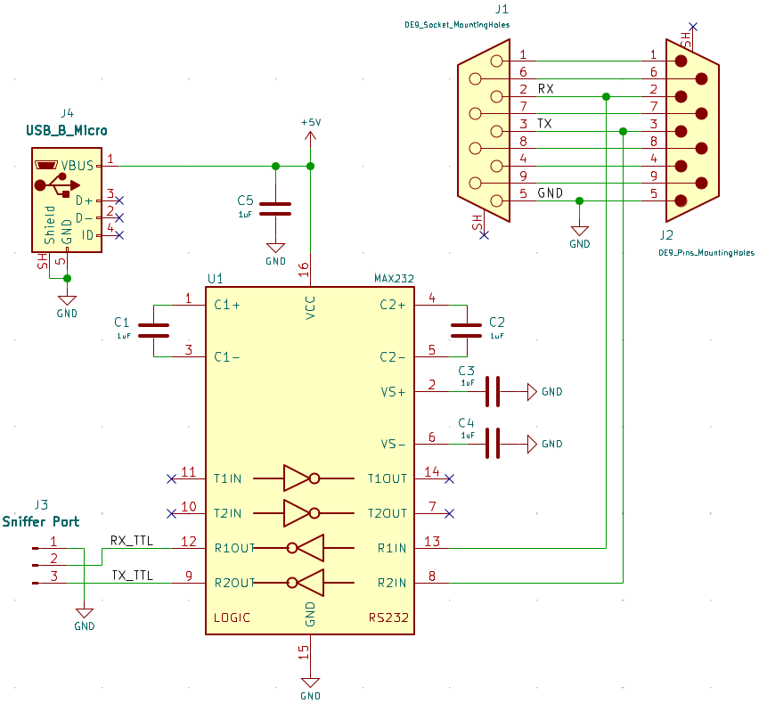
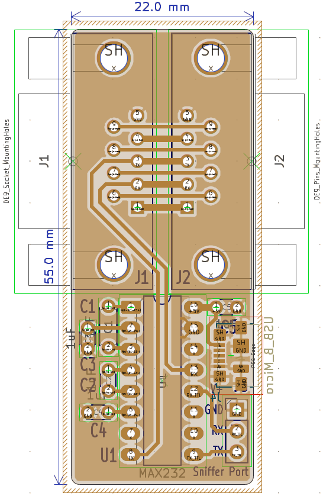
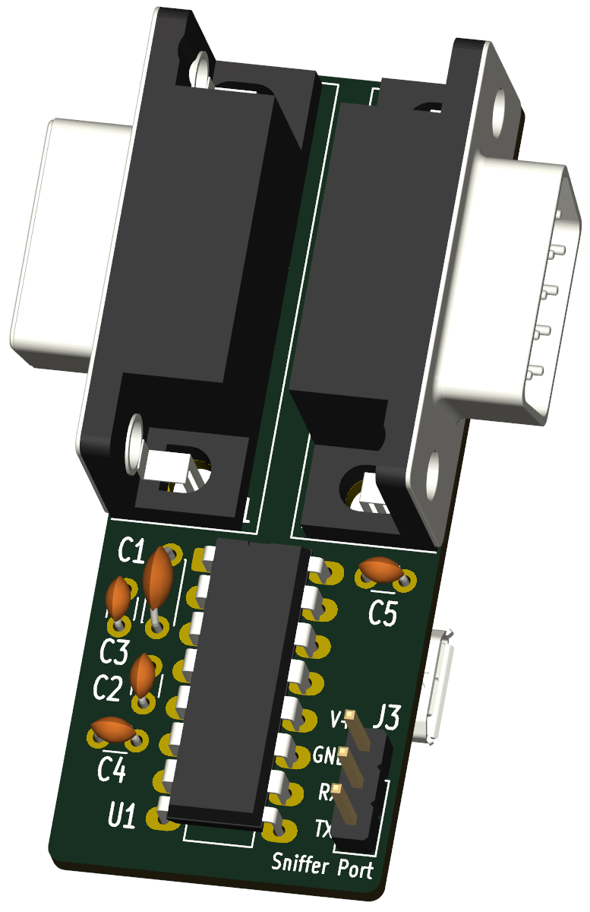

# Dust Extraction System Control (DES-Ctrl)

[](LICENSE)
[](https://kicad.org/)

Solución de hardware y firmware de código abierto diseñada para replicar y controlar la interfaz de extracción de polvo mediante aspiración en las trazadoras de placas de circuito impreso **LPKF ProtoMat**, utilizando sistemas de aspiración comerciales asequibles.

Desarrollado como proyecto académico para la asignatura **Laboratorio de Electrónica III** en la Escuela de Ingeniería Eléctrica de la **Universidad de Los Andes (ULA)**, Mérida, Venezuela.

---

## Descripción general del proyecto

Los sistemas originales LPKF ProtoMat emplean una unidad de extracción de polvo por vacío sincronizada, controlada mediante una interfaz serie UART conectada directamente a la fresadora. Cuando las unidades de extracción originales no están presentes o no se encuentran disponibles, su sustitución por hardware específico resulta económicamente prohibitiva.

**DES-Ctrl** resuelve este desafío mediante un enfoque de hardware de dos etapas:
1. **PCB1 (Sniffer / Man-in-the-Middle):** Una interfaz de diagnóstico (pasiva/activa) que cuenta con conectores DB9 macho/hembra y puntos de prueba para interceptar, registrar y analizar los paquetes de comunicación UART entre una LPKF ProtoMat y su sistema original de extracción de polvo.
2. **PCB2 (Controlador y etapa de potencia):** Una placa con microcontrolador integrado, equipada con detección de cruce por cero y conmutación mediante triac/tiristor, diseñada para regular la velocidad y la potencia de una aspiradora comercial estándar y los estados operativos de la máquina LPKF.

## PCB1 Sniffer

| Schematic | Layout | 3d-Model |
| :--------: | :--------: | :--------: |
|  |  |   |

---

## Repository Structure

```text
DES-Ctrl/
├── hardware/
│   ├── pcb1_sniffer/          # Interceptor UART y puntos de prueba de LPKF
│   └── pcb2_controller/       # Microcontrolador y etapa de potencia con detección de cruce por cero
├── firmware/                  # Firmware de MCU para la decodificación de paquetes y el control de motores
├── docs/                      # Notas técnicas, capturas de protocolos y esquemas
└── LICENSE                    # MIT Open Source License
